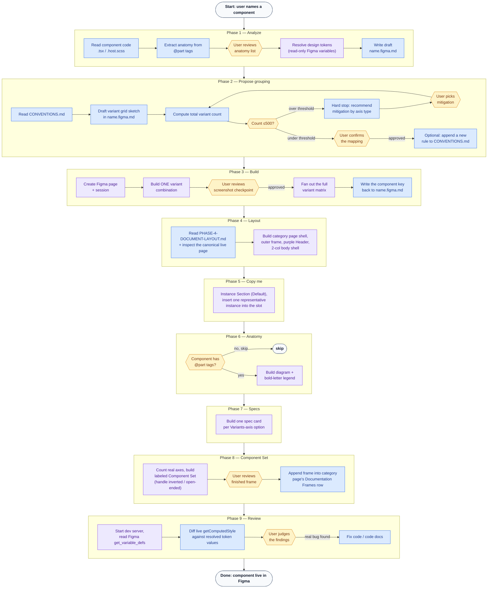

# ds-code-to-figma

## Goal

Generate Figma components that accurately represent the existing Web Components and reuse existing design system resources.

## Workflow

Each phase lives in its own file — read the current phase's file when you reach it, don't load
all nine up front. Each file opens with a "you are here" line naming what the prior phase must
have produced, and closes with an explicit `Next:` pointer to the following file.

1. [`PHASE-1-ANALYZE.md`](PHASE-1-ANALYZE.md) — read the component's code (props, anatomy,
   pseudo-states, text attributes) and resolve every value to a Figma design token, hard-stopping
   on anything that can't be resolved. Writes the draft `<name>.figma.md`.
2. [`PHASE-2-PROPOSE.md`](PHASE-2-PROPOSE.md) — turn the draft into a concrete Figma
   variant-grouping proposal (variant vs. instance-swap vs. top-level split, grid sketch, 500-variant
   budget check) and get the user's explicit sign-off before anything is built.
3. [`PHASE-3-BUILD.md`](PHASE-3-BUILD.md) — find or create the component's shared category page
   (`Core / <Category>`), build the real Figma `COMPONENT_SET` incrementally (one confirmed
   variant combination first, then fan out the rest), and append its master set into that page's
   masters row.
4. [`PHASE-4-DOCUMENT-LAYOUT.md`](PHASE-4-DOCUMENT-LAYOUT.md) — build the per-component
   documentation frame's layout from the fixed page template: the category page shell (once per
   category), the outer frame, the purple header, and the 2-column body shell.
5. [`PHASE-5-DOCUMENT-COPY-ME.md`](PHASE-5-DOCUMENT-COPY-ME.md) — build "👉 Copy me", the first
   section of the left column.
6. [`PHASE-6-DOCUMENT-ANATOMY.md`](PHASE-6-DOCUMENT-ANATOMY.md) — build "🏗️ Anatomy", the second
   section of the left column (skipped entirely when the component has no `@part` tags).
7. [`PHASE-7-DOCUMENT-SPECS.md`](PHASE-7-DOCUMENT-SPECS.md) — build "📐 Specs", the last section of
   the left column.
8. [`PHASE-8-DOCUMENT-COMPONENT-SET.md`](PHASE-8-DOCUMENT-COMPONENT-SET.md) — build "🔒 Component
   Set" in the right column (handling an `inverted` axis or an open-ended content-selection prop as
   needed), then append the finished frame into the category page's documentation-frames row.
9. [`PHASE-9-REVIEW.md`](PHASE-9-REVIEW.md) — compare the built Figma output against real visual
   regression baselines and report findings; this is the last phase in this skill's v1 scope.

### Graph

🔵 **code** — reads or writes a file in this repo (`.tsx`/`.scss`, `name.figma.md`, `CONVENTIONS.md`, test snapshots).
🟣 **figma** — a `use_figma`/`get_screenshot` call against the live Figma file.
🟡 **human** — a required stop-and-wait checkpoint; never assume approval and keep going.

The three human checkpoints (Phase 1's anatomy review, Phase 2's mapping confirmation, Phase 3's
first-variant screenshot) are the only _required_ stops — everything else is read/write work it
does on its own between them. For the full list of every checkpoint and hard-stop condition across
all nine phases in one place, see [`DECISIONS.md`](DECISIONS.md).

## Rules

- NEVER generate Code Connect mappings
- NEVER update an existing Figma component
- NEVER invent a hardcoded value — always resolve to a Figma variable (design token)
- NEVER commit — leave changes unstaged for the user to review
- MUST treat a hard stop (missing token, missing nested child mapping) as a checkpoint, not a failure to work around — surface it and wait for the user's decision

## Instructions

Load `figma-use` alongside this skill before any `use_figma` call (mandatory per that skill's own
rule). Load `figma-generate-library` for its guidance on binding values to Figma variables and
reusing existing components, since the same discipline applies here.

## Prerequisites

- `figma.config.json` at the repo root must have a real `componentLibraryFileKey` (not the
  `REPLACE_WITH_FIGMA_FILE_KEY` placeholder). If it's still the placeholder, stop and ask the
  user for the file key before doing anything else.
- The target component must already exist in code (`packages/core/src/components/<category>/<name>/`).
- If the component nests another DS component (e.g. a button using an icon), the nested
  component's own `<child>.figma.md` must already exist and record a Figma component key. If it
  doesn't, stop and tell the user to run this skill on the child component first — do not
  recreate the child or fall back to a plain shape.

## References

Read only the documentation needed for the task:

- [`CONVENTIONS.md`](CONVENTIONS.md) — current mapping heuristics, indexed by topic into
  [`conventions/`](conventions/) (tokens & props, variant grouping, page structure, Component Set
  rendering, general build mechanics).
- [`DECISIONS.md`](DECISIONS.md) — every checkpoint and hard-stop condition across all nine
  phases, in one place.
- `PHASE-1-ANALYZE.md` / `PHASE-2-PROPOSE.md` / `PHASE-3-BUILD.md` / `PHASE-4-DOCUMENT-LAYOUT.md` /
  `PHASE-5-DOCUMENT-COPY-ME.md` / `PHASE-6-DOCUMENT-ANATOMY.md` / `PHASE-7-DOCUMENT-SPECS.md` /
  `PHASE-8-DOCUMENT-COMPONENT-SET.md` / `PHASE-9-REVIEW.md` — the full workflow, one file per
  phase (see "## Workflow" above).
- [`packages/tokens/CONTEXT.md`](../../../packages/tokens/CONTEXT.md) — token layers and naming.
- [`packages/core/CONTEXT.md`](../../../packages/core/CONTEXT.md) — component categories and
  structure.
- [`examples/mapping-file-format.md`](examples/mapping-file-format.md) — code to figma mapping format.

## Validation

- All applicable styles must use design tokens.
- Nested components must use existing instances.
- Report unresolved mappings.
- All Figma component keys must be written back to `<name>.figma.md` for future reference.

## Output

Provide:

- `<name>.figma.md` lives at `packages/core/src/components/<category>/<name>/<name>.figma.md`.
- `CONVENTIONS.md` is updated only when the user approves a new rule addition.
- Created Figma component — documentation frames and component set
- Validation results
- Unresolved issues
