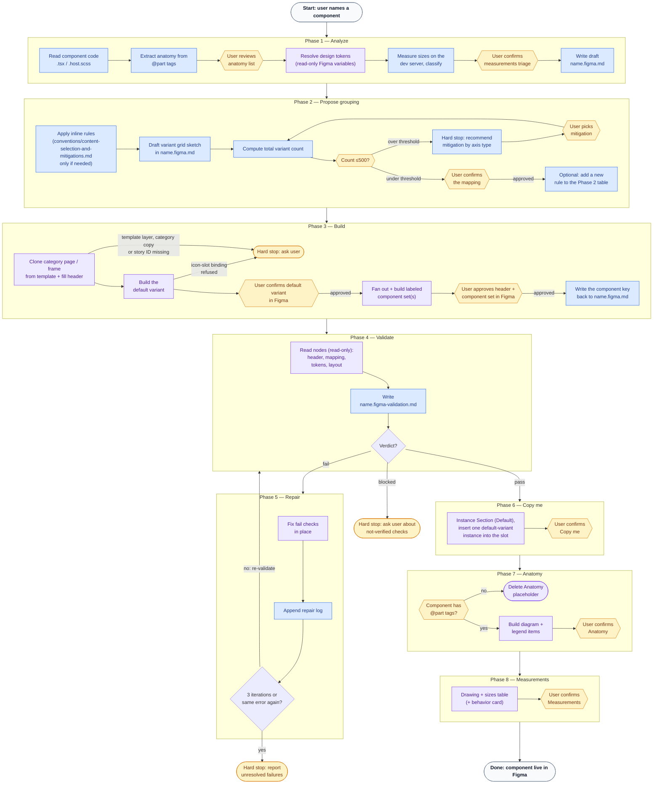

# ds-code-to-figma

## Goal

Generate Figma components that accurately represent the existing Web Components and reuse existing design system resources.

The unit of work is a **family**: the documentation owner (the component with a Storybook page)
plus its sub-components (e.g. `ds-tabs` + `ds-tab` + `ds-tab-panel`). One run builds every set of
the family into the owner's one documentation frame — see
[`conventions/families.md`](conventions/families.md).

## Workflow

Each phase lives in its own file — read the current phase's file when you reach it, don't load
all eight up front. Each file opens with a "you are here" line naming what the prior phase must
have produced, and closes with an explicit `Next:` pointer to the following file.

1. [`PHASE-1-ANALYZE.md`](PHASE-1-ANALYZE.md) — read the component's code (props, anatomy,
   pseudo-states, text attributes) and resolve every value to a Figma design token, hard-stopping
   on anything that can't be resolved, then measures the component's sizes on the dev server and
   triages which ones Measurements shows. Writes the draft `<name>.figma.md`.
2. [`PHASE-2-PROPOSE.md`](PHASE-2-PROPOSE.md) — turn the draft into a concrete Figma
   variant-grouping proposal (variant vs. instance-swap vs. top-level split, grid sketch, 500-variant
   budget check) and get the user's explicit sign-off before anything is built.
3. [`PHASE-3-BUILD.md`](PHASE-3-BUILD.md) — clone the component's category page (or just its documentation
   frame) from the `🗂️ Template / Category` Figma page and fill its header, then build the real
   Figma `COMPONENT_SET` inside that frame incrementally (the confirmed default variant first,
   then the rest as a labeled, fixed-grid set the user approves).
4. [`PHASE-4-VALIDATE.md`](PHASE-4-VALIDATE.md) — read-only check of the built header, prop/state
   mapping, token bindings and set layout against the plan and template; writes
   `<name>.figma-validation.md` with a `pass` / `fail` / `blocked` verdict.
5. [`PHASE-5-REPAIR.md`](PHASE-5-REPAIR.md) — fix every `fail` check in place, then re-run Phase 4
   (max 3 iterations, then hard stop).
6. [`PHASE-6-DOCUMENT-COPY-ME.md`](PHASE-6-DOCUMENT-COPY-ME.md) — build "👉 Copy me", the first
   section of the left column.
7. [`PHASE-7-DOCUMENT-ANATOMY.md`](PHASE-7-DOCUMENT-ANATOMY.md) — build "🏗️ Anatomy", the second
   section of the left column (the placeholder is deleted when the component has no `@part` tags).
8. [`PHASE-8-DOCUMENT-MEASUREMENTS.md`](PHASE-8-DOCUMENT-MEASUREMENTS.md) — build "📏 Measurements", the last section of
   the left column: a drawing, a sizes table and, for content-driven components, a behavior
   card; this is the last phase.

### Graph

🔵 **code** — reads or writes a file in this repo (`.tsx`/`.scss`, `name.figma.md`, `CONVENTIONS.md`, test snapshots).
🟣 **figma** — a `use_figma`/`get_screenshot` call against the live Figma file.
🟡 **human** — a required stop-and-wait checkpoint; never assume approval and keep going.

The human checkpoints (Phase 1's anatomy review and measurements triage, Phase 2's mapping confirmation, Phase 3's
first-variant and documentation-frame approvals in Figma, and the Copy me / Anatomy / Measurements
confirmations in Phases 6–8) are the only _required_ stops. Phases 4–5 run on their own and stop
only on a `blocked` verdict or a repair hard stop. For the full list of every checkpoint and
hard-stop condition across all eight phases in one place, see [`DECISIONS.md`](DECISIONS.md).

## Rules

- NEVER generate Code Connect mappings
- NEVER invent a hardcoded value — always resolve to a Figma variable (design token)
- NEVER commit — leave changes unstaged for the user to review
- MUST treat a hard stop (missing token, missing nested component mapping) as a stop-and-wait point, not a failure to work around — surface it and wait for the user's decision
- MUST run on the documentation owner and build the whole family; a sub-component never runs alone (`conventions/families.md`)

## Instructions

Load `figma-use` alongside this skill before any `use_figma` call (mandatory per that skill's own
rule). Load `figma-generate-library` for its guidance on binding values to Figma variables and
reusing existing components, since the same discipline applies here.

## Prerequisites

- `figma.config.json` at the repo root must have a real `componentLibraryFileKey` (not the
  `REPLACE_WITH_FIGMA_FILE_KEY` placeholder). If it's still the placeholder, stop and ask the
  user for the file key before doing anything else.
- The target component must already exist in code (`packages/core/src/components/<category>/<name>/`).
- If the family uses a **nested component** (an independent DS component from another family, e.g.
  a button using an icon), the nested component's own `<child>.figma.md` must already exist and
  record a Figma component key. If it doesn't, stop and tell the user to run this skill on the
  nested component first — do not recreate it or fall back to a plain shape.
- **Sub-components** (same family folder, no Storybook page of their own) are the exception: they
  are not a prerequisite — this run builds them, per `conventions/families.md`.

## References

Read only the documentation needed for the task:

- [`CONVENTIONS.md`](CONVENTIONS.md) — cross-phase rules (category copy, no-lock, no assumed attributes), indexed by topic into
  [`conventions/`](conventions/) (tokens & props, content-selection & mitigations, page structure, Component Set
  rendering, general build mechanics).
- [`conventions/families.md`](conventions/families.md) — owner / sub-component resolution, lockstep
  phases, parent-set props, slots, anatomy and measurements for families (every phase).
- [`DECISIONS.md`](DECISIONS.md) — every checkpoint and hard-stop condition across all eight
  phases, in one place.
- `PHASE-1-ANALYZE.md` … `PHASE-8-DOCUMENT-MEASUREMENTS.md` — the full workflow, one file per phase (see
  "## Workflow" above).
- [`packages/tokens/CONTEXT.md`](../../../packages/tokens/CONTEXT.md) — token layers and naming.
- [`packages/core/CONTEXT.md`](../../../packages/core/CONTEXT.md) — component categories and
  structure.
- [`examples/mapping-file-format.md`](examples/mapping-file-format.md) — code to figma mapping format.

## Validation

- All applicable styles must use design tokens.
- Nested components and sub-components must use instances of their own sets.
- Icon slots (`ds-icon` / `ds-brand-icon`) use one `INSTANCE_SWAP` property each.
- Report unresolved mappings.
- All Figma component keys must be written back to `<name>.figma.md` for future reference.

## Output

Provide:

- `<name>.figma.md` next to each family member's `.tsx` — one per member (owner and every
  sub-component).
- `PHASE-2-PROPOSE.md`'s mapping table, `CONVENTIONS.md` and `conventions/*.md` are updated only when the user approves a new rule addition.
- Created Figma component — documentation frames and component set
- Validation results — `<name>.figma-validation.md` (Phase 4, with the Phase 5 repair log)
- Unresolved issues
